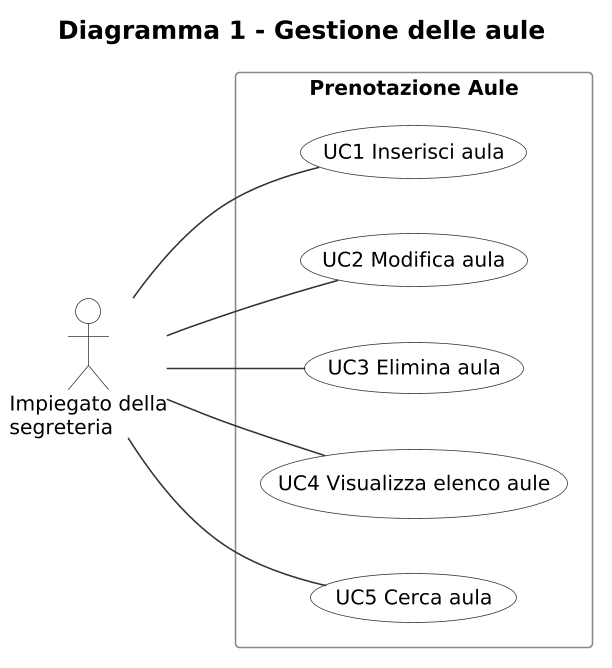

# Diagramma 1 – Gestione delle aule

Sorgente: [`diagramma-1-aule.puml`](diagramma-1-aule.puml)

## Elementi rappresentati

| Elemento | Tipo | Descrizione |
|---|---|---|
| Impiegato della segreteria | Attore | Unico utente dell'applicazione; gestisce l'anagrafica delle aule |
| UC1 Inserisci aula | Caso d'uso | Registra una nuova aula con codice, nome, edificio, piano e capienza |
| UC2 Modifica aula | Caso d'uso | Aggiorna i dati di un'aula esistente, tranne il codice; le sue prenotazioni riportano i dati aggiornati |
| UC3 Elimina aula | Caso d'uso | Cancella un'aula senza prenotazioni future, insieme alle sue prenotazioni passate |
| UC4 Visualizza elenco aule | Caso d'uso | Mostra tutte le aule, ordinate per codice |
| UC5 Cerca aula | Caso d'uso | Filtra le aule per nome, codice o capienza minima |

## Commento

Il diagramma raccoglie le operazioni sull'anagrafica delle aule, che corrispondono ai requisiti FI1.1–FI1.12. L'unico attore è l'impiegato della segreteria, che partecipa direttamente a tutti i casi d'uso: le linee continue indicano questa partecipazione.

Non ci sono relazioni tra i casi d'uso. La verifica dei dati (codice univoco, capienza positiva) è un passo interno di UC1 e UC2 e non viene riusata altrove, quindi non è stata estratta in un caso d'uso incluso. Il controllo sulle prenotazioni future in UC3 è descritto come flusso alternativo, perché è un passo dello stesso caso d'uso e non un'interazione separata.

UC4 e UC5 sono distinti perché hanno obiettivi diversi: UC4 mostra l'intero elenco, UC5 restringe l'elenco a un criterio. UC2 e UC3 partono dalla selezione di un'aula in uno di questi due elenchi.
