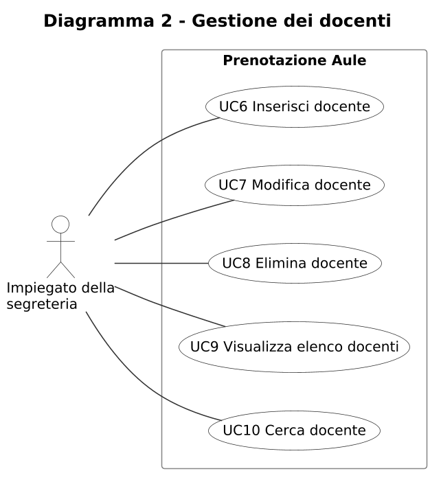

# Diagramma 2 – Gestione dei docenti

Sorgente: [`diagramma-2-docenti.puml`](diagramma-2-docenti.puml)

## Elementi rappresentati

| Elemento | Tipo | Descrizione |
|---|---|---|
| Impiegato della segreteria | Attore | Unico utente dell'applicazione; gestisce l'anagrafica dei docenti |
| UC6 Inserisci docente | Caso d'uso | Registra un nuovo docente con e-mail istituzionale, nome e cognome |
| UC7 Modifica docente | Caso d'uso | Aggiorna e-mail, nome e cognome di un docente; le sue prenotazioni future riportano i dati aggiornati, quelle passate restano invariate |
| UC8 Elimina docente | Caso d'uso | Cancella un docente senza prenotazioni future, insieme alle sue prenotazioni passate |
| UC9 Visualizza elenco docenti | Caso d'uso | Mostra tutti i docenti, ordinati per cognome e nome |
| UC10 Cerca docente | Caso d'uso | Filtra i docenti per cognome o per e-mail istituzionale |

## Commento

Il diagramma ha la stessa struttura del diagramma 1, perché l'anagrafica dei docenti si gestisce con le stesse operazioni di quella delle aule. Corrisponde ai requisiti FI2.1–FI2.11. Il docente non compare come attore: è un dato gestito dal sistema, perché non usa direttamente l'applicazione.

Anche qui non ci sono relazioni tra i casi d'uso. Le differenze rispetto alle aule sono nei dati e nei criteri: la chiave univoca è l'e-mail istituzionale, che a differenza del codice dell'aula si può modificare (assunzione A7), l'elenco è ordinato per cognome e nome, e la ricerca avviene per cognome o per e-mail (assunzione A2).
