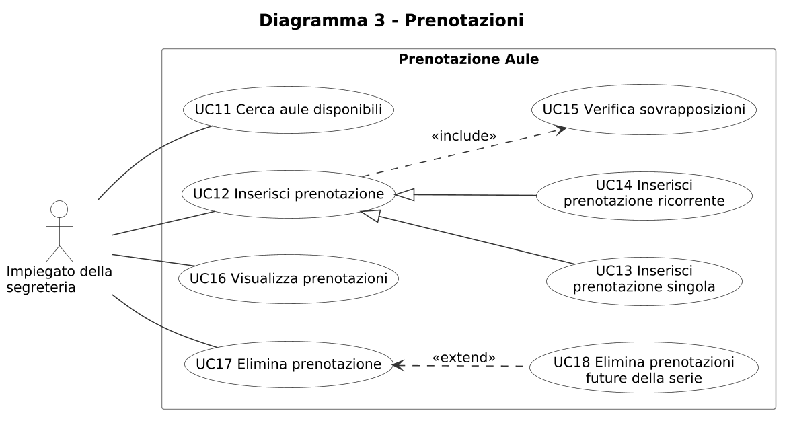

# Diagramma 3 – Prenotazioni

Sorgente: [`diagramma-3-prenotazioni.puml`](diagramma-3-prenotazioni.puml)

## Elementi rappresentati

| Elemento | Tipo | Descrizione |
|---|---|---|
| Impiegato della segreteria | Attore | Unico utente dell'applicazione; cerca le aule libere e gestisce le prenotazioni |
| UC11 Cerca aule disponibili | Caso d'uso | Trova le aule libere in una data e fascia oraria, con eventuale capienza minima |
| UC12 Inserisci prenotazione | Caso d'uso generale | Raccoglie i passi comuni a ogni inserimento: scelta di aula e docente, dati dell'attività, verifica dei dati |
| UC13 Inserisci prenotazione singola | Specializzazione di UC12 | Inserisce una sola prenotazione |
| UC14 Inserisci prenotazione ricorrente | Specializzazione di UC12 | Genera e inserisce le occorrenze settimanali fino alla data di termine |
| UC15 Verifica sovrapposizioni | Caso d'uso incluso | Controlla che aula e docente non siano già impegnati |
| UC16 Visualizza prenotazioni | Caso d'uso | Mostra le prenotazioni in ordine di data e ora, filtrate per aula o docente |
| UC17 Elimina prenotazione | Caso d'uso | Cancella una singola prenotazione |
| UC18 Elimina prenotazioni future della serie | Estensione di UC17 | Cancella tutte le occorrenze future di una serie |

## Commento

È il diagramma più articolato, perché qui si usano tutti e tre i tipi di relazione tra casi d'uso.

**Specializzazione (UC13, UC14 → UC12).** L'inserimento singolo e quello ricorrente hanno lo stesso inizio: si scelgono aula e docente e si indicano tipo, denominazione, data e orari. Cambia solo la parte finale, cioè una prenotazione oppure una serie di occorrenze. Per questo UC12 descrive i passi comuni e le due specializzazioni descrivono ciò che le distingue. La freccia con il triangolo vuoto punta verso il caso d'uso generale. L'impiegato è collegato solo a UC12: per la specializzazione partecipa anche a UC13 e UC14, senza bisogno di altre linee.

**Inclusione (UC12 → UC15).** La verifica delle sovrapposizioni si esegue *sempre*, sia per una prenotazione singola sia per ogni occorrenza di una serie. Per questo è un caso d'uso incluso: la freccia tratteggiata «include» va dal caso d'uso che include a quello incluso. Estrarla evita di ripetere lo stesso controllo nelle due specializzazioni e rende esplicita la regola centrale del sistema, cioè nessuna sovrapposizione né per aula né per docente.

**Estensione (UC18 → UC17).** La cancellazione delle occorrenze future avviene *solo in certe condizioni*: la prenotazione selezionata deve appartenere a una serie e l'impiegato deve scegliere di cancellare anche le occorrenze successive. Negli altri casi UC17 cancella solo la prenotazione selezionata. Per questo UC18 è un'estensione: la freccia tratteggiata «extend» va dal caso d'uso che estende a quello esteso.

UC11 è un caso d'uso autonomo, perché l'impiegato può cercare le aule libere anche solo per rispondere a una richiesta, senza prenotare. Dal risultato può comunque avviare l'inserimento (UC12) con i dati già compilati: è un collegamento di interfaccia (IU9), non una relazione tra casi d'uso.
