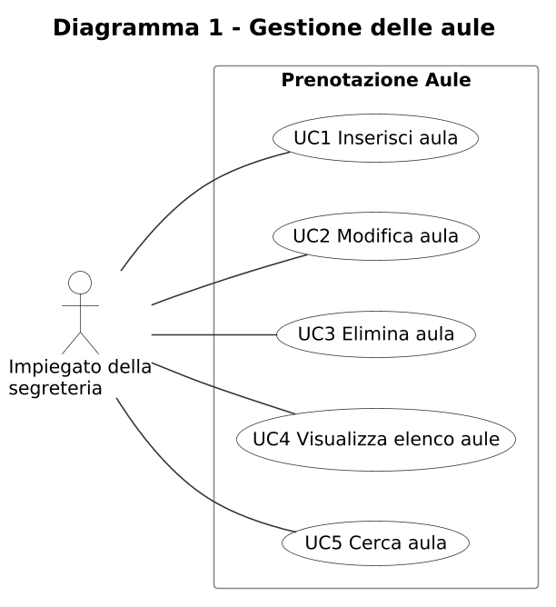
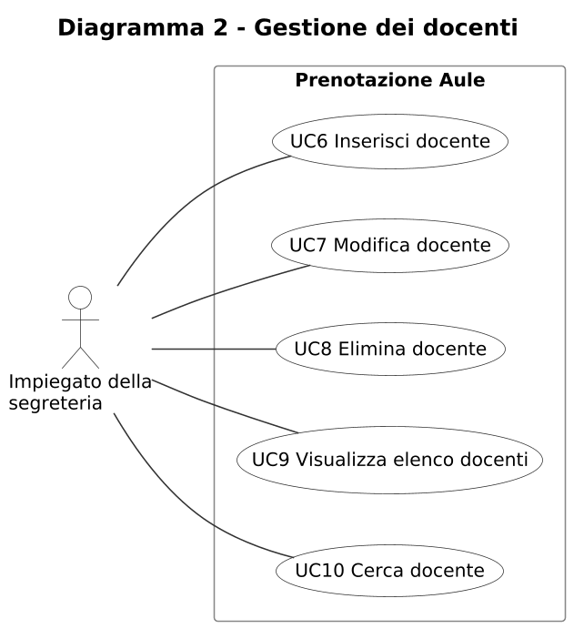
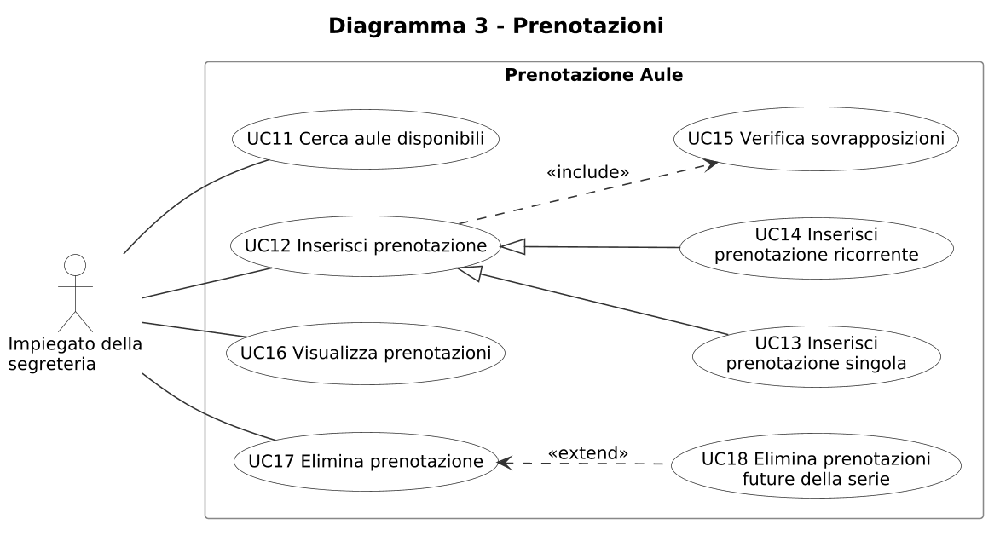

# Documento di Specifica dei Requisiti – Prenotazione Aule

Gruppo 4

## 1. Descrizione dell'applicazione

### 1.1 Scopo dell'applicazione

L'applicazione gestisce le prenotazioni delle aule di un dipartimento universitario. Ha tre obiettivi:

1. mantenere un'anagrafica aggiornata delle aule e dei docenti del dipartimento;
2. permettere di trovare rapidamente un'aula libera in una data e in una fascia oraria e di prenotarla, per un'attività singola o ripetuta ogni settimana;
3. garantire che non si verifichino sovrapposizioni: un'aula non può essere occupata contemporaneamente da più docenti e un docente non può trovarsi contemporaneamente in più aule.

### 1.2 Ambito

Il sistema è un'applicazione desktop con interfaccia grafica, usata dall'impiegato della segreteria del dipartimento. Copre la gestione di aule, docenti e prenotazioni e la conservazione dei dati su file.

Gli orari ufficiali delle lezioni e il calendario degli esami vengono gestiti con il sistema: l'impiegato li inserisce una sola volta, le lezioni come prenotazioni ricorrenti e gli esami come prenotazioni delle aule in cui si svolgono.

Restano fuori dal sistema:

- la gestione degli studenti;
- lo scambio di comunicazioni con i docenti: le richieste di prenotazione arrivano all'impiegato per e-mail, per telefono o di persona, e con gli stessi canali l'impiegato comunica l'esito. L'applicazione non invia comunicazioni o notifiche.

### 1.3 Funzionalità principali

- Inserimento, modifica, cancellazione e consultazione delle aule, con ricerca per nome, codice o capienza minima.
- Inserimento, modifica, cancellazione e consultazione dei docenti, con elenco ordinato per cognome e nome e ricerca per cognome o e-mail istituzionale.
- Ricerca delle aule disponibili in una data e in una fascia oraria, con eventuale capienza minima.
- Inserimento di prenotazioni singole o ricorrenti, con cadenza settimanale fino a una data di termine.
- Controllo automatico delle sovrapposizioni, per aula e per docente.
- Visualizzazione delle prenotazioni in ordine di data e ora, filtrate per aula o per docente.
- Cancellazione di una singola prenotazione o di tutte le prenotazioni future di una serie ricorrente.
- Salvataggio automatico dell'archivio su file e ripristino all'avvio.

### 1.4 Attori coinvolti

| Attore | Tipo | Ruolo nel sistema |
|---|---|---|
| Impiegato della segreteria | Persona | Unico utente dell'applicazione: gestisce e organizza l'anagrafica di aule e docenti, cerca le aule disponibili, inserisce e cancella le prenotazioni e consulta l'occupazione delle aule |

I docenti compaiono nel sistema come dati, perché sono i responsabili delle prenotazioni, ma non usano direttamente l'applicazione. Il sistema non interagisce con sistemi esterni: l'archivio è un file locale.

### 1.5 Assunzioni

La descrizione delle funzionalità richieste non specifica alcuni aspetti. Il gruppo ha adottato queste assunzioni:

- **A1.** L'applicazione non richiede autenticazione: è installata sul computer della segreteria ed è usata da una persona alla volta.
- **A2.** Il "codice identificativo" con cui cercare un docente è il suo indirizzo e-mail istituzionale, l'unico dato univoco previsto per i docenti.
- **A3.** La ricerca per nome dell'aula e per cognome del docente trova anche corrispondenze parziali e non distingue maiuscole e minuscole (ad esempio "ross" trova "Rossi" e "Rossini"). La ricerca per codice dell'aula e per e-mail del docente richiede il valore completo, sempre senza distinguere maiuscole e minuscole.
- **A4.** Una prenotazione inizia e finisce nello stesso giorno: non può proseguire oltre la mezzanotte, quindi è descritta da una sola data, un'ora di inizio e un'ora di fine. La fascia oraria comprende l'ora di inizio ed esclude l'ora di fine: una prenotazione che termina alle 11:00 non si sovrappone a una che inizia alle 11:00.
- **A5.** Una prenotazione ricorrente si ripete ogni settimana, nello stesso giorno della settimana e con lo stesso orario, dalla data indicata fino alla data di termine compresa. Se anche una sola occorrenza si sovrappone a una prenotazione esistente, l'intera serie viene rifiutata: il gruppo ha preferito evitare serie incomplete inserite senza che l'impiegato se ne accorga.
- **A6.** L'impiegato non modifica direttamente una prenotazione: per cambiarne i dati la cancella e la inserisce di nuovo, perché le funzionalità richieste prevedono solo l'inserimento e la cancellazione delle prenotazioni. Restano validi gli aggiornamenti automatici dovuti alla modifica dei dati di un'aula o di un docente (A7).
- **A7.** Il codice dell'aula la identifica e non è modificabile: per correggerlo si cancella e si reinserisce l'aula. Tutti gli altri dati dell'aula e tutti i dati del docente, compresa l'e-mail istituzionale, sono modificabili. Le modifiche ai dati di un'aula valgono per tutte le sue prenotazioni, perché l'aula resta lo stesso spazio fisico. Le modifiche ai dati di un docente valgono solo per le sue prenotazioni future: quelle passate conservano i dati che il docente aveva quando si sono svolte.
- **A8.** Un'aula o un docente con prenotazioni future non possono essere cancellati, per non lasciare prenotazioni senza aula o senza responsabile: l'impiegato deve prima cancellare quelle prenotazioni. Le prenotazioni passate vengono invece cancellate insieme all'aula o al docente.
- **A9.** Le "prenotazioni future" di una serie sono le occorrenze che iniziano dopo il momento in cui si esegue la cancellazione; le occorrenze già iniziate o svolte restano in archivio.
- **A10.** Non si possono inserire prenotazioni con data e ora di inizio già passate.
- **A11.** I tipi di attività sono una lista fissa: Lezione, Esame, Seminario, Altro. "Altro" copre i casi non previsti, che sono comunque descritti dalla denominazione dell'attività.
- **A12.** La capienza è un numero intero maggiore di zero. Il piano è un numero intero: 0 indica il piano terra, i valori negativi i piani interrati.
- **A13.** Un'e-mail istituzionale ha un formato valido se non contiene spazi, contiene una sola @ con del testo prima e dopo, e la parte dopo la @ contiene almeno un punto (ad esempio m.rossi@unisa.it). Non si verifica che il dominio esista.
- **A14.** I valori numerici dei requisiti non funzionali (sezione 3) sono stime del gruppo, basate su un dipartimento di medie dimensioni: fino a 200 aule, 500 docenti e 20.000 prenotazioni in archivio.
- **A15.** L'elenco delle aule è ordinato per codice, perché la descrizione delle funzionalità non indica un ordinamento.
- **A16.** L'archivio viene salvato automaticamente dopo ogni modifica, senza un comando di salvataggio esplicito, per non perdere dati se l'impiegato dimentica di salvare.

### 1.6 Glossario

| Termine | Significato |
|---|---|
| **Aula** | Spazio del dipartimento che può essere prenotato, identificato da un codice univoco. |
| **Docente** | Persona responsabile di una prenotazione, identificata dall'e-mail istituzionale. |
| **Impiegato della segreteria** | Unico utente dell'applicazione: lavora nella segreteria del dipartimento e la usa per gestire e organizzare aule, docenti e prenotazioni. |
| **Prenotazione** | Occupazione di un'aula da parte di un docente per un'attività, in una data e fascia oraria. |
| **Fascia oraria** | Intervallo tra l'ora di inizio e l'ora di fine di una prenotazione, nella stessa giornata; l'ora di fine è esclusa (A4). |
| **Prenotazione ricorrente, serie** | Insieme di prenotazioni con gli stessi dati che si ripetono ogni settimana, nello stesso giorno e orario, dalla data della prima fino alla data di termine. |
| **Occorrenza** | Singola prenotazione che fa parte di una serie. |
| **Sovrapposizione** | Situazione in cui due prenotazioni della stessa aula, o dello stesso docente, cadono nella stessa data con fasce orarie che si intersecano. |
| **Prenotazione futura** | Prenotazione la cui data e ora di inizio sono successive al momento corrente. |
| **Aula disponibile** | Aula che non ha prenotazioni sovrapposte alla data e alla fascia oraria richieste. |
| **Archivio** | Insieme dei dati di aule, docenti e prenotazioni, salvato su file. |

## 2. Requisiti funzionali

I requisiti sono classificati con uno schema a prefissi: BF (business flow), FI (funzionalità individuale), ED (esigenza di dati e informazioni), IU (interfaccia utente), IS (interfaccia con sistemi esterni). La priorità esprime il valore per il committente:

- **MUST HAVE**: senza questo requisito il sistema non è utilizzabile;
- **SHOULD HAVE**: importante, ma la sua assenza non comporta un fallimento;
- **NICE TO HAVE**: da soddisfare solo se non richiede grandi sforzi.

I casi d'uso richiamati (UC) sono descritti nella sezione 4; le assunzioni (A) nella sezione 1.5.

### 2.1 Business flow (BF)

| Codice | Business flow | Priorità |
|---|---|---|
| BF1 | **Aggiornamento dell'anagrafica.** Quando cambiano gli spazi o il personale del dipartimento (una nuova aula, un'aula ristrutturata, un nuovo docente), l'impiegato inserisce, modifica o cancella i dati di aule e docenti. Il sistema controlla che i dati siano validi e che codici ed e-mail non siano duplicati. | MUST HAVE |
| BF2 | **Prenotazione di un'attività singola.** Un docente chiede un'aula per un'attività in una certa data e fascia oraria (ad esempio un esame o un seminario), indicando il numero di partecipanti. L'impiegato cerca le aule disponibili in quella fascia con capienza adeguata, ne sceglie una e inserisce la prenotazione. Il sistema verifica che né l'aula né il docente siano già impegnati e la registra. | MUST HAVE |
| BF3 | **Prenotazione di un corso.** Per un corso che si tiene ogni settimana, l'impiegato inserisce una prenotazione ricorrente indicando la data della prima lezione e la data di termine. Il sistema genera le occorrenze settimanali, verifica che nessuna si sovrapponga ad altre prenotazioni e registra l'intera serie. | MUST HAVE |
| BF4 | **Consultazione dell'occupazione.** Per rispondere alle richieste o pianificare il periodo successivo, l'impiegato visualizza in ordine cronologico le prenotazioni di un'aula o di un docente. | MUST HAVE |
| BF5 | **Annullamento.** Se un'attività viene annullata, l'impiegato cancella la prenotazione. Se un corso termina prima del previsto, cancella in un'unica operazione tutte le prenotazioni future della serie; quelle già svolte restano in archivio. | MUST HAVE |
| BF6 | **Conservazione dei dati.** Ogni modifica all'archivio viene salvata subito su file. Alla successiva apertura dell'applicazione l'impiegato ritrova l'archivio com'era. | MUST HAVE |

### 2.2 Funzionalità individuali (FI)

Le funzionalità individuali sono caratterizzate in base a due criteri: la priorità di realizzazione, con i livelli definiti sopra, e il rischio tecnico della realizzazione: **Alto** se è difficile prevedere se si riuscirà a realizzarla nei tempi, **Medio** se è realizzabile ma con alcuni fattori di rischio, **Basso** se la realizzazione non presenta difficoltà particolari.

**FI1 – Gestione delle aule**

| Codice | Requisito | Priorità | Rischio | Casi d'uso |
|---|---|---|---|---|
| FI1.1 | Il sistema deve consentire all'impiegato di inserire un'aula indicando codice, nome, edificio, piano e capienza. | MUST HAVE | Basso | UC1 |
| FI1.2 | Il sistema deve rifiutare l'inserimento di un'aula il cui codice è già presente in archivio, senza distinguere maiuscole e minuscole. | MUST HAVE | Basso | UC1 |
| FI1.3 | Il sistema deve rifiutare i dati di un'aula se un campo è vuoto, se il piano non è un numero intero o se la capienza non è un numero intero maggiore di zero (A12). | MUST HAVE | Basso | UC1, UC2 |
| FI1.4 | Il sistema deve consentire di modificare nome, edificio, piano e capienza di un'aula; il codice non è modificabile (A7). | MUST HAVE | Basso | UC2 |
| FI1.5 | Il sistema deve consentire di cancellare un'aula, dopo la conferma dell'impiegato. | MUST HAVE | Basso | UC3 |
| FI1.6 | Il sistema deve impedire la cancellazione di un'aula che ha prenotazioni future (A8). | MUST HAVE | Medio | UC3 |
| FI1.7 | Quando cancella un'aula, il sistema deve cancellare anche le sue prenotazioni passate (A8). | MUST HAVE | Medio | UC3 |
| FI1.8 | Il sistema deve mostrare l'elenco di tutte le aule, ordinato per codice (A15). | MUST HAVE | Basso | UC4 |
| FI1.9 | Il sistema deve consentire di cercare le aule il cui nome contiene un testo dato (A3). | MUST HAVE | Basso | UC5 |
| FI1.10 | Il sistema deve consentire di cercare un'aula per codice (A3). | MUST HAVE | Basso | UC5 |
| FI1.11 | Il sistema deve consentire di cercare le aule con capienza maggiore o uguale a un valore dato. | MUST HAVE | Basso | UC5 |
| FI1.12 | Quando i dati di un'aula vengono modificati, tutte le prenotazioni di quell'aula devono riportare i dati aggiornati (A7). | MUST HAVE | Basso | UC2 |

**FI2 – Gestione dei docenti**

| Codice | Requisito | Priorità | Rischio | Casi d'uso |
|---|---|---|---|---|
| FI2.1 | Il sistema deve consentire all'impiegato di inserire un docente indicando e-mail istituzionale, nome e cognome. | MUST HAVE | Basso | UC6 |
| FI2.2 | Il sistema deve rifiutare l'inserimento o la modifica di un docente se la sua e-mail è già usata da un altro docente in archivio, senza distinguere maiuscole e minuscole. | MUST HAVE | Basso | UC6, UC7 |
| FI2.3 | Il sistema deve rifiutare i dati di un docente se nome o cognome sono vuoti o se l'e-mail non ha un formato valido, secondo le regole dell'assunzione A13. | MUST HAVE | Basso | UC6, UC7 |
| FI2.4 | Il sistema deve consentire di modificare e-mail istituzionale, nome e cognome di un docente (A7). | MUST HAVE | Basso | UC7 |
| FI2.5 | Il sistema deve consentire di cancellare un docente, dopo la conferma dell'impiegato. | MUST HAVE | Basso | UC8 |
| FI2.6 | Il sistema deve impedire la cancellazione di un docente che ha prenotazioni future (A8). | MUST HAVE | Medio | UC8 |
| FI2.7 | Quando cancella un docente, il sistema deve cancellare anche le sue prenotazioni passate (A8). | MUST HAVE | Medio | UC8 |
| FI2.8 | Il sistema deve mostrare l'elenco di tutti i docenti, ordinato per cognome e, a parità di cognome, per nome, senza distinguere maiuscole e minuscole. | MUST HAVE | Basso | UC9 |
| FI2.9 | Il sistema deve consentire di cercare i docenti il cui cognome contiene un testo dato (A3). | MUST HAVE | Basso | UC10 |
| FI2.10 | Il sistema deve consentire di cercare un docente per e-mail istituzionale (A2, A3). | MUST HAVE | Basso | UC10 |
| FI2.11 | Quando i dati di un docente vengono modificati, le sue prenotazioni future devono riportare i dati aggiornati; le prenotazioni passate restano invariate (A7). | MUST HAVE | Medio | UC7 |

**FI3 – Prenotazioni**

| Codice | Requisito | Priorità | Rischio | Casi d'uso |
|---|---|---|---|---|
| FI3.1 | Il sistema deve consentire di cercare le aule disponibili in una data e in una fascia oraria, cioè le aule che non hanno prenotazioni sovrapposte a quella fascia (A4); l'impiegato può indicare anche una capienza minima, e in questo caso il sistema mostra solo le aule disponibili con almeno quella capienza. | MUST HAVE | Medio | UC11 |
| FI3.2 | Il sistema deve consentire di inserire una prenotazione singola indicando aula, docente responsabile, tipo di attività, denominazione dell'attività, data, ora di inizio e ora di fine. | MUST HAVE | Basso | UC12, UC13 |
| FI3.3 | Il sistema deve consentire di inserire una prenotazione ricorrente, cioè un'attività che si ripete ogni settimana nello stesso giorno e con lo stesso orario (ad esempio le lezioni di un corso). Oltre ai dati di FI3.2, l'impiegato indica la data di termine della ripetizione; il sistema crea una prenotazione (occorrenza) per ogni settimana, a partire dalla data indicata e fino alla data di termine compresa (A5). | MUST HAVE | Medio | UC12, UC14 |
| FI3.4 | Il sistema deve rifiutare una prenotazione se un campo è vuoto o se l'ora di fine non è successiva all'ora di inizio. | MUST HAVE | Basso | UC12 |
| FI3.5 | Il sistema deve rifiutare una prenotazione la cui data e ora di inizio sono già passate (A10). | SHOULD HAVE | Basso | UC12 |
| FI3.6 | Il sistema deve rifiutare una prenotazione ricorrente la cui data di termine precede la data della prima occorrenza. | MUST HAVE | Basso | UC14 |
| FI3.7 | Il sistema deve rifiutare una prenotazione che si sovrappone a una prenotazione esistente della stessa aula (A4). | MUST HAVE | Medio | UC15 |
| FI3.8 | Il sistema deve rifiutare una prenotazione che si sovrappone a una prenotazione esistente dello stesso docente, anche in un'aula diversa (A4). | MUST HAVE | Medio | UC15 |
| FI3.9 | Il sistema deve rifiutare per intero una prenotazione ricorrente se almeno una sua occorrenza viola FI3.7 o FI3.8; in questo caso non viene inserita nessuna occorrenza (A5). | MUST HAVE | Medio | UC14, UC15 |
| FI3.10 | Il sistema deve mostrare le prenotazioni ordinate per data e ora di inizio. | MUST HAVE | Basso | UC16 |
| FI3.11 | Il sistema deve consentire di visualizzare solo le prenotazioni di un'aula scelta dall'impiegato. | MUST HAVE | Basso | UC16 |
| FI3.12 | Il sistema deve consentire di visualizzare solo le prenotazioni di un docente scelto dall'impiegato. | MUST HAVE | Basso | UC16 |
| FI3.13 | Il sistema deve consentire di cancellare una singola prenotazione, anche se appartiene a una serie, dopo la conferma dell'impiegato; le altre occorrenze della serie restano invariate. | MUST HAVE | Basso | UC17 |
| FI3.14 | Il sistema deve consentire di cancellare in un'unica operazione tutte le prenotazioni future di una serie, dopo la conferma dell'impiegato; le occorrenze passate restano in archivio (A9). | MUST HAVE | Medio | UC18 |

L'impiegato non può modificare direttamente una prenotazione già inserita: per cambiarne i dati la cancella e la inserisce di nuovo (A6). Gli aggiornamenti dovuti alla modifica di un'aula o di un docente avvengono in automatico (FI1.12, FI2.11).

**FI4 – Archivio**

| Codice | Requisito | Priorità | Rischio | Casi d'uso |
|---|---|---|---|---|
| FI4.1 | Il sistema deve salvare su file l'archivio di aule, docenti e prenotazioni dopo ogni operazione che lo modifica (A16). | MUST HAVE | Medio | — (automatico) |
| FI4.2 | All'avvio il sistema deve caricare l'archivio dal file. | MUST HAVE | Medio | — (avvio) |
| FI4.3 | Se all'avvio il file dell'archivio non esiste, il sistema deve partire con un archivio vuoto e creare il file al primo salvataggio. | MUST HAVE | Basso | — (avvio) |
| FI4.4 | Se all'avvio il file dell'archivio non è leggibile o è danneggiato, il sistema deve segnalarlo all'impiegato e non deve sovrascriverlo senza la sua conferma. | SHOULD HAVE | Medio | — (avvio) |
| FI4.5 | Se il salvataggio su file non riesce (ad esempio per disco pieno o file in sola lettura), il sistema deve segnalarlo all'impiegato. | SHOULD HAVE | Basso | — (automatico) |

### 2.3 Esigenze di dati e informazioni (ED)

| Codice | Requisito | Priorità |
|---|---|---|
| ED1 | Per ogni aula il sistema deve memorizzare: codice (univoco), nome, edificio, piano, capienza. | MUST HAVE |
| ED2 | Per ogni docente il sistema deve memorizzare: e-mail istituzionale (univoca), nome, cognome. | MUST HAVE |
| ED3 | Per ogni prenotazione il sistema deve memorizzare: aula, docente responsabile, tipo di attività, denominazione dell'attività, data, ora di inizio, ora di fine. | MUST HAVE |
| ED4 | Per ogni occorrenza di una prenotazione ricorrente il sistema deve memorizzare la serie a cui appartiene e la data di termine della serie, così da poter riconoscere le occorrenze della stessa serie. | MUST HAVE |
| ED5 | I tipi di attività ammessi sono: Lezione, Esame, Seminario, Altro (A11). | MUST HAVE |
| ED6 | L'archivio deve conservare anche le prenotazioni passate, finché non vengono cancellate. | SHOULD HAVE |

### 2.4 Interfacce utente (IU)

| Codice | Requisito | Priorità |
|---|---|---|
| IU1 | La finestra principale deve offrire tre sezioni distinte, Aule, Docenti e Prenotazioni, raggiungibili con un solo clic (ad esempio tramite schede). | MUST HAVE |
| IU2 | Gli elenchi di aule, docenti e prenotazioni devono essere mostrati in tabelle, con una colonna per ciascun dato. | MUST HAVE |
| IU3 | In caso di dati non validi il sistema deve indicare quale campo è errato e quale vincolo deve rispettare (ad esempio "La capienza deve essere un numero intero maggiore di zero"). | MUST HAVE |
| IU4 | Quando una prenotazione viene rifiutata per sovrapposizione, il sistema deve mostrare le prenotazioni in conflitto con aula, docente, data e fascia oraria; per una prenotazione ricorrente, l'elenco delle date in conflitto. | MUST HAVE |
| IU5 | Prima di ogni cancellazione il sistema deve chiedere conferma, indicando cosa verrà cancellato (ad esempio la prenotazione selezionata, oppure il numero di occorrenze future di una serie). | MUST HAVE |
| IU6 | Nell'inserimento di una prenotazione, aula e docente devono essere scelti tra quelli presenti in archivio, non digitati a mano. | MUST HAVE |
| IU7 | Le date devono essere inserite tramite un selettore di calendario e gli orari nel formato hh:mm (24 ore). | SHOULD HAVE |
| IU8 | Nell'elenco delle prenotazioni deve essere riconoscibile se una prenotazione appartiene a una serie ricorrente. | SHOULD HAVE |
| IU9 | Dall'elenco delle aule disponibili l'impiegato deve poter avviare l'inserimento di una prenotazione per l'aula scelta, con data e fascia oraria già compilate. | NICE TO HAVE |
| IU10 | Le tabelle devono poter essere riordinate cliccando sull'intestazione di una colonna. | NICE TO HAVE |

### 2.5 Interfacce con sistemi esterni (IS)

Il sistema non scambia dati con altri sistemi, quindi non sono previsti requisiti di questa categoria. L'archivio è salvato su un file locale (FI4.1, NF11).

### 2.6 Casi d'uso richiamati

UC1 Inserisci aula · UC2 Modifica aula · UC3 Elimina aula · UC4 Visualizza elenco aule · UC5 Cerca aula · UC6 Inserisci docente · UC7 Modifica docente · UC8 Elimina docente · UC9 Visualizza elenco docenti · UC10 Cerca docente · UC11 Cerca aule disponibili · UC12 Inserisci prenotazione · UC13 Inserisci prenotazione singola · UC14 Inserisci prenotazione ricorrente · UC15 Verifica sovrapposizioni · UC16 Visualizza prenotazioni · UC17 Elimina prenotazione · UC18 Elimina prenotazioni future della serie

## 3. Requisiti non funzionali

I requisiti non funzionali qualificano le funzionalità della sezione 2 e si applicano al sistema nel suo complesso. I vincoli sono separati dagli altri requisiti e hanno tutti priorità massima (MUST HAVE). I valori numerici sono stime del gruppo (assunzione A14).

### 3.1 Requisiti di qualità

| Codice | Requisito | Categoria | Priorità |
|---|---|---|---|
| NF1 | Con un archivio delle dimensioni indicate in A14, la ricerca delle aule disponibili, l'inserimento di una prenotazione (anche ricorrente, fino a 52 occorrenze) e la visualizzazione delle prenotazioni devono completarsi in meno di 1 secondo. | Prestazioni | SHOULD HAVE |
| NF2 | Con un archivio delle dimensioni indicate in A14, l'avvio dell'applicazione, compreso il caricamento dell'archivio, deve richiedere meno di 5 secondi. | Prestazioni | SHOULD HAVE |
| NF3 | Una modifica confermata dall'impiegato non deve andare persa se l'applicazione si chiude in modo imprevisto dopo la conferma. | Affidabilità | MUST HAVE |
| NF4 | Un salvataggio interrotto non deve lasciare un file incompleto: al riavvio deve essere disponibile l'ultimo archivio salvato per intero. | Affidabilità | SHOULD HAVE |
| NF5 | Ogni funzionalità elencata nella sezione 1.3 deve essere raggiungibile dalla finestra principale con al massimo 3 clic. | Usabilità | SHOULD HAVE |
| NF6 | Tutti i testi e i messaggi dell'interfaccia devono essere in lingua italiana. | Usabilità | MUST HAVE |

### 3.2 Vincoli

| Codice | Vincolo | Categoria | Priorità |
|---|---|---|---|
| NF7 | L'applicazione deve essere scritta in Java, con interfaccia grafica realizzata in JavaFX. | Tecnologia | MUST HAVE |
| NF8 | Il progetto deve poter essere compilato, testato ed eseguito tramite Maven. | Strumenti di sviluppo | MUST HAVE |
| NF9 | L'interfaccia pubblica delle classi deve essere documentata con Doxygen. | Documentazione | MUST HAVE |
| NF10 | Ogni classe, escluse quelle dell'interfaccia grafica, deve avere unit test automatici JUnit, che devono essere tutti superati. | Processo di sviluppo | MUST HAVE |
| NF11 | L'archivio deve essere salvato su un file locale. | Persistenza | MUST HAVE |
| NF12 | L'applicazione deve funzionare su Windows, macOS e Linux. | Piattaforma | MUST HAVE |
| NF13 | Il codice sorgente e la documentazione devono essere gestiti con Git, in un repository GitHub accessibile pubblicamente in lettura. | Processo di sviluppo | MUST HAVE |
| NF14 | L'applicazione è usata da un solo impiegato alla volta: non è richiesto l'accesso contemporaneo di più utenti allo stesso archivio (A1). | Utenza | MUST HAVE |

## 4. Casi d'uso

I casi d'uso sono 18, divisi in tre diagrammi UML: gestione delle aule, gestione dei docenti e prenotazioni. I diagrammi fanno da indice; le informazioni complete sono nelle descrizioni della sezione 4.4. I sorgenti PlantUML dei diagrammi e un commento più esteso si trovano nella cartella `diagrammi/casi-uso` del repository.

Notazione: linea continua = partecipazione dell'attore; freccia tratteggiata «include» = passo sempre eseguito; freccia tratteggiata «extend» = caso eccezionale, eseguito solo in certe condizioni; freccia con triangolo vuoto = specializzazione, verso l'elemento più generale.

### 4.1 Diagramma 1 – Gestione delle aule

*Diagramma dei casi d'uso 1 · gestione delle aule*

L'impiegato della segreteria partecipa direttamente a tutti i casi d'uso dell'anagrafica delle aule. Non ci sono relazioni tra i casi d'uso: la verifica dei dati e il controllo delle prenotazioni future sono passi interni di UC1, UC2 e UC3 e non vengono riusati altrove. UC2 e UC3 partono dalla selezione di un'aula nell'elenco completo (UC4) o nel risultato di una ricerca (UC5).

### 4.2 Diagramma 2 – Gestione dei docenti

*Diagramma dei casi d'uso 2 · gestione dei docenti*

La struttura è la stessa del diagramma 1, perché l'anagrafica dei docenti si gestisce con le stesse operazioni. Il docente non è un attore: è un dato gestito dal sistema, perché non usa direttamente l'applicazione. Cambiano la chiave univoca (l'e-mail istituzionale, che a differenza del codice dell'aula è modificabile), l'ordinamento dell'elenco (cognome e nome) e i criteri di ricerca (cognome o e-mail).

### 4.3 Diagramma 3 – Prenotazioni

*Diagramma dei casi d'uso 3 · prenotazioni*

Inserisci prenotazione (UC12) raccoglie i passi comuni a ogni inserimento ed è specializzato da UC13 (prenotazione singola) e UC14 (prenotazione ricorrente), che differiscono solo nella parte finale. UC12 include sempre la verifica delle sovrapposizioni (UC15), eseguita per la prenotazione singola e per ogni occorrenza di una serie. Elimina prenotazioni future della serie (UC18) estende Elimina prenotazione (UC17), perché si esegue solo quando la prenotazione selezionata appartiene a una serie e l'impiegato sceglie di cancellare anche le occorrenze successive. UC11 è autonomo: l'impiegato può cercare le aule libere anche senza prenotare.

### 4.4 Descrizione dei casi d'uso

Ogni caso d'uso segue lo schema: nome, attori partecipanti, precondizioni, postcondizioni, flusso di eventi normale e flussi alternativi. In tutti i casi d'uso si assume come precondizione che l'applicazione sia avviata e l'archivio caricato (FI4.2): le precondizioni indicate sono quelle aggiuntive. Nei casi d'uso che modificano l'archivio, se il salvataggio su file non riesce il sistema lo segnala all'impiegato (FI4.5).

#### UC1 – Inserisci aula

- **Attori partecipanti:** Impiegato della segreteria.
- **Precondizioni:** nessuna.
- **Postcondizioni:** l'aula è presente in archivio e l'archivio è salvato su file.
- **Flusso di eventi normale:**

    1. L'impiegato apre la sezione Aule e sceglie "Nuova aula".
    2. Il sistema mostra il modulo con i campi codice, nome, edificio, piano e capienza.
    3. L'impiegato compila i campi e conferma.
    4. Il sistema verifica i dati (FI1.3).
    5. Il sistema verifica che il codice non sia già presente in archivio (FI1.2).
    6. Il sistema registra l'aula (FI1.1), salva l'archivio (FI4.1) e la mostra nell'elenco.

- **Flussi alternativi:**

    - 3a. L'impiegato annulla: il caso d'uso termina senza modifiche.
    - 4a. Un dato non è valido: il sistema indica il campo errato e il vincolo da rispettare (IU3); si riprende dal passo 3.
    - 5a. Il codice è già presente: il sistema lo segnala (IU3); si riprende dal passo 3.

#### UC2 – Modifica aula

- **Attori partecipanti:** Impiegato della segreteria.
- **Precondizioni:** in archivio è presente almeno un'aula.
- **Postcondizioni:** i dati dell'aula sono aggiornati, anche nelle sue prenotazioni, e l'archivio è salvato su file.
- **Flusso di eventi normale:**

    1. L'impiegato seleziona un'aula nell'elenco (UC4 o UC5) e sceglie "Modifica".
    2. Il sistema mostra il modulo con i dati attuali; il codice è visibile ma non modificabile (FI1.4).
    3. L'impiegato modifica nome, edificio, piano o capienza e conferma.
    4. Il sistema verifica i dati (FI1.3).
    5. Il sistema aggiorna l'aula, anche nelle prenotazioni che la riguardano (FI1.12), e salva l'archivio (FI4.1).

- **Flussi alternativi:**

    - 3a. L'impiegato annulla: il caso d'uso termina senza modifiche.
    - 4a. Un dato non è valido: il sistema indica il campo errato e il vincolo da rispettare (IU3); si riprende dal passo 3.

#### UC3 – Elimina aula

- **Attori partecipanti:** Impiegato della segreteria.
- **Precondizioni:** in archivio è presente almeno un'aula.
- **Postcondizioni:** l'aula e le sue prenotazioni passate non sono più in archivio; l'archivio è salvato su file.
- **Flusso di eventi normale:**

    1. L'impiegato seleziona un'aula nell'elenco (UC4 o UC5) e sceglie "Elimina".
    2. Il sistema verifica che l'aula non abbia prenotazioni future (FI1.6).
    3. Il sistema chiede conferma, avvisando che insieme all'aula verranno cancellate anche le sue prenotazioni passate (IU5).
    4. L'impiegato conferma.
    5. Il sistema cancella l'aula e le sue prenotazioni passate (FI1.5, FI1.7) e salva l'archivio (FI4.1).

- **Flussi alternativi:**

    - 2a. L'aula ha prenotazioni future: il sistema impedisce la cancellazione e indica quante sono (FI1.6); il caso d'uso termina.
    - 4a. L'impiegato annulla: il caso d'uso termina senza modifiche.

#### UC4 – Visualizza elenco aule

- **Attori partecipanti:** Impiegato della segreteria.
- **Precondizioni:** nessuna.
- **Postcondizioni:** l'impiegato ha visualizzato l'elenco delle aule.
- **Flusso di eventi normale:**

    1. L'impiegato apre la sezione Aule.
    2. Il sistema mostra tutte le aule in una tabella con codice, nome, edificio, piano e capienza, ordinate per codice (FI1.8, IU2).

- **Flussi alternativi:**

    - 2a. Non ci sono aule in archivio: il sistema mostra la tabella vuota e un messaggio che invita a inserirne una (UC1).

#### UC5 – Cerca aula

- **Attori partecipanti:** Impiegato della segreteria.
- **Precondizioni:** nessuna.
- **Postcondizioni:** l'elenco mostra solo le aule che soddisfano il criterio scelto.
- **Flusso di eventi normale:**

    1. Nella sezione Aule l'impiegato sceglie il criterio di ricerca: nome, codice o capienza minima.
    2. L'impiegato inserisce il valore da cercare e avvia la ricerca.
    3. Il sistema mostra le aule che soddisfano il criterio (FI1.9, FI1.10, FI1.11), ordinate per codice.

- **Flussi alternativi:**

    - 2a. Per la capienza minima l'impiegato inserisce un valore che non è un numero intero maggiore di zero: il sistema lo segnala (IU3); si riprende dal passo 2.
    - 3a. Nessuna aula soddisfa il criterio: il sistema mostra il messaggio "Nessuna aula trovata".
    - 3b. L'impiegato cancella il criterio di ricerca: il sistema torna a mostrare l'elenco completo (UC4).

#### UC6 – Inserisci docente

- **Attori partecipanti:** Impiegato della segreteria.
- **Precondizioni:** nessuna.
- **Postcondizioni:** il docente è presente in archivio e l'archivio è salvato su file.
- **Flusso di eventi normale:**

    1. L'impiegato apre la sezione Docenti e sceglie "Nuovo docente".
    2. Il sistema mostra il modulo con i campi e-mail istituzionale, nome e cognome.
    3. L'impiegato compila i campi e conferma.
    4. Il sistema verifica i dati (FI2.3).
    5. Il sistema verifica che l'e-mail non sia già presente in archivio (FI2.2).
    6. Il sistema registra il docente (FI2.1), salva l'archivio (FI4.1) e lo mostra nell'elenco.

- **Flussi alternativi:**

    - 3a. L'impiegato annulla: il caso d'uso termina senza modifiche.
    - 4a. Un dato non è valido: il sistema indica il campo errato e il vincolo da rispettare (IU3); si riprende dal passo 3.
    - 5a. L'e-mail è già presente: il sistema lo segnala (IU3); si riprende dal passo 3.

#### UC7 – Modifica docente

- **Attori partecipanti:** Impiegato della segreteria.
- **Precondizioni:** in archivio è presente almeno un docente.
- **Postcondizioni:** i dati del docente sono aggiornati, anche nelle sue prenotazioni future; le prenotazioni passate sono invariate e l'archivio è salvato su file.
- **Flusso di eventi normale:**

    1. L'impiegato seleziona un docente nell'elenco (UC9 o UC10) e sceglie "Modifica".
    2. Il sistema mostra il modulo con i dati attuali: e-mail istituzionale, nome e cognome.
    3. L'impiegato modifica e-mail, nome o cognome e conferma.
    4. Il sistema verifica i dati (FI2.3).
    5. Se l'e-mail è cambiata, il sistema verifica che non sia già usata da un altro docente (FI2.2).
    6. Il sistema aggiorna il docente (FI2.4) e le sue prenotazioni future, lasciando invariate quelle passate (FI2.11), e salva l'archivio (FI4.1).

- **Flussi alternativi:**

    - 3a. L'impiegato annulla: il caso d'uso termina senza modifiche.
    - 4a. Un dato non è valido: il sistema indica il campo errato e il vincolo da rispettare (IU3); si riprende dal passo 3.
    - 5a. L'e-mail è già usata da un altro docente: il sistema lo segnala (IU3); si riprende dal passo 3.

#### UC8 – Elimina docente

- **Attori partecipanti:** Impiegato della segreteria.
- **Precondizioni:** in archivio è presente almeno un docente.
- **Postcondizioni:** il docente e le sue prenotazioni passate non sono più in archivio; l'archivio è salvato su file.
- **Flusso di eventi normale:**

    1. L'impiegato seleziona un docente nell'elenco (UC9 o UC10) e sceglie "Elimina".
    2. Il sistema verifica che il docente non abbia prenotazioni future (FI2.6).
    3. Il sistema chiede conferma, avvisando che insieme al docente verranno cancellate anche le sue prenotazioni passate (IU5).
    4. L'impiegato conferma.
    5. Il sistema cancella il docente e le sue prenotazioni passate (FI2.5, FI2.7) e salva l'archivio (FI4.1).

- **Flussi alternativi:**

    - 2a. Il docente ha prenotazioni future: il sistema impedisce la cancellazione e indica quante sono (FI2.6); il caso d'uso termina.
    - 4a. L'impiegato annulla: il caso d'uso termina senza modifiche.

#### UC9 – Visualizza elenco docenti

- **Attori partecipanti:** Impiegato della segreteria.
- **Precondizioni:** nessuna.
- **Postcondizioni:** l'impiegato ha visualizzato l'elenco dei docenti.
- **Flusso di eventi normale:**

    1. L'impiegato apre la sezione Docenti.
    2. Il sistema mostra tutti i docenti in una tabella con cognome, nome ed e-mail, ordinati per cognome e nome (FI2.8, IU2).

- **Flussi alternativi:**

    - 2a. Non ci sono docenti in archivio: il sistema mostra la tabella vuota e un messaggio che invita a inserirne uno (UC6).

#### UC10 – Cerca docente

- **Attori partecipanti:** Impiegato della segreteria.
- **Precondizioni:** nessuna.
- **Postcondizioni:** l'elenco mostra solo i docenti che soddisfano il criterio scelto.
- **Flusso di eventi normale:**

    1. Nella sezione Docenti l'impiegato sceglie il criterio di ricerca: cognome o e-mail istituzionale.
    2. L'impiegato inserisce il valore da cercare e avvia la ricerca.
    3. Il sistema mostra i docenti che soddisfano il criterio (FI2.9, FI2.10), ordinati per cognome e nome.

- **Flussi alternativi:**

    - 2a. L'impiegato avvia la ricerca senza inserire un valore: il sistema lo segnala (IU3); si riprende dal passo 2.
    - 3a. Nessun docente soddisfa il criterio: il sistema mostra il messaggio "Nessun docente trovato".
    - 3b. L'impiegato cancella il criterio di ricerca: il sistema torna a mostrare l'elenco completo (UC9).

#### UC11 – Cerca aule disponibili

- **Attori partecipanti:** Impiegato della segreteria.
- **Precondizioni:** nessuna.
- **Postcondizioni:** l'impiegato ha visualizzato le aule libere nella data e fascia oraria richieste.
- **Flusso di eventi normale:**

    1. L'impiegato apre la sezione Prenotazioni e sceglie "Cerca aule disponibili".
    2. L'impiegato indica data, ora di inizio, ora di fine (IU7) e, se vuole, una capienza minima (FI3.1), poi avvia la ricerca.
    3. Il sistema verifica che l'ora di fine sia successiva all'ora di inizio.
    4. Il sistema mostra, ordinate per codice, le aule che non hanno prenotazioni sovrapposte alla fascia indicata e che hanno almeno la capienza richiesta (FI3.1).

- **Flussi alternativi:**

    - 3a. L'ora di fine non è successiva all'ora di inizio, oppure la capienza minima non è un numero intero maggiore di zero: il sistema indica il campo errato (IU3); si riprende dal passo 2.
    - 4a. Nessuna aula è disponibile: il sistema mostra il messaggio "Nessuna aula disponibile"; si riprende dal passo 2.
    - 4b. L'impiegato seleziona un'aula e sceglie "Prenota": si avvia l'inserimento di una prenotazione (UC12) con aula, data e fascia oraria già compilate (IU9).

#### UC12 – Inserisci prenotazione

- **Attori partecipanti:** Impiegato della segreteria.
- **Tipo:** caso d'uso generale, specializzato da UC13 e UC14; include UC15.
- **Precondizioni:** in archivio sono presenti almeno un'aula e almeno un docente.
- **Postcondizioni:** le nuove prenotazioni sono presenti in archivio e l'archivio è salvato su file.
- **Flusso di eventi normale:**

    1. L'impiegato sceglie "Nuova prenotazione".
    2. Il sistema mostra il modulo con: aula e docente da scegliere tra quelli in archivio (IU6), tipo di attività (ED5), denominazione, data, ora di inizio, ora di fine (IU7) e l'opzione "Ripeti ogni settimana fino al", con la data di termine (FI3.2, FI3.3).
    3. L'impiegato compila i campi e conferma.
    4. Il sistema verifica i dati (FI3.4, FI3.5).
    5. Il sistema esegue la variante specifica: UC13 se la prenotazione è singola, UC14 se è ricorrente. In entrambe verifica le sovrapposizioni (UC15).

- **Flussi alternativi:**

    - 3a. L'impiegato annulla: il caso d'uso termina senza modifiche.
    - 4a. Un dato non è valido o la data e l'ora di inizio sono già passate: il sistema indica il campo errato e il vincolo da rispettare (IU3); si riprende dal passo 3.

#### UC13 – Inserisci prenotazione singola

- **Attori partecipanti:** Impiegato della segreteria.
- **Tipo:** specializza UC12.
- **Precondizioni:** è in corso UC12, i dati sono validi e l'opzione di ripetizione settimanale non è selezionata.
- **Postcondizioni:** la prenotazione è presente in archivio e l'archivio è salvato su file.
- **Flusso di eventi normale:**

    1. Il sistema verifica che la prenotazione non si sovrapponga ad altre (UC15).
    2. Il sistema registra la prenotazione (FI3.2), salva l'archivio (FI4.1) e la mostra nell'elenco delle prenotazioni.

- **Flussi alternativi:**

    - 1a. La prenotazione si sovrappone ad altre: il sistema la rifiuta e mostra le prenotazioni in conflitto (IU4); si riprende dal passo 3 di UC12.

#### UC14 – Inserisci prenotazione ricorrente

- **Attori partecipanti:** Impiegato della segreteria.
- **Tipo:** specializza UC12.
- **Precondizioni:** è in corso UC12, i dati sono validi ed è selezionata l'opzione di ripetizione settimanale con la data di termine.
- **Postcondizioni:** tutte le occorrenze della serie sono presenti in archivio, collegate alla stessa serie (ED4), e l'archivio è salvato su file.
- **Flusso di eventi normale:**

    1. Il sistema verifica che la data di termine non preceda la data della prima occorrenza (FI3.6).
    2. Il sistema genera un'occorrenza per ogni settimana, nello stesso giorno della settimana e con lo stesso orario, dalla data indicata fino alla data di termine compresa (FI3.3).
    3. Il sistema verifica che nessuna occorrenza si sovrapponga ad altre prenotazioni (UC15).
    4. Il sistema registra tutte le occorrenze come un'unica serie, salva l'archivio (FI4.1) e indica quante prenotazioni ha inserito.

- **Flussi alternativi:**

    - 1a. La data di termine precede la data della prima occorrenza: il sistema lo segnala (IU3); si riprende dal passo 3 di UC12.
    - 3a. Almeno un'occorrenza si sovrappone ad altre prenotazioni: il sistema rifiuta l'intera serie senza inserire nessuna occorrenza (FI3.9) e mostra le date in conflitto (IU4); si riprende dal passo 3 di UC12.

#### UC15 – Verifica sovrapposizioni

- **Attori partecipanti:** nessuno; il caso d'uso è eseguito dal sistema durante l'inserimento.
- **Tipo:** incluso in UC12, e quindi eseguito sia in UC13 sia in UC14.
- **Precondizioni:** sono disponibili i dati validi delle prenotazioni da inserire (una, o tutte le occorrenze di una serie).
- **Postcondizioni:** il sistema sa se le prenotazioni possono essere inserite e, in caso contrario, quali prenotazioni esistenti sono in conflitto.
- **Flusso di eventi normale:**

    1. Per ogni prenotazione da inserire, il sistema cerca in archivio le prenotazioni della stessa aula, nella stessa data, con fascia oraria che si interseca con quella nuova (FI3.7, A4).
    2. Per ogni prenotazione da inserire, il sistema cerca in archivio le prenotazioni dello stesso docente, in qualunque aula, nella stessa data, con fascia oraria che si interseca con quella nuova (FI3.8, A4).
    3. Non ci sono conflitti: il sistema conferma che le prenotazioni possono essere inserite.

- **Flussi alternativi:**

    - 3a. Ci sono conflitti: il sistema restituisce l'elenco delle prenotazioni in conflitto al caso d'uso che lo ha incluso, che rifiuta l'inserimento (FI3.9, IU4).

#### UC16 – Visualizza prenotazioni

- **Attori partecipanti:** Impiegato della segreteria.
- **Precondizioni:** nessuna.
- **Postcondizioni:** l'impiegato ha visualizzato le prenotazioni richieste.
- **Flusso di eventi normale:**

    1. L'impiegato apre la sezione Prenotazioni.
    2. Il sistema mostra tutte le prenotazioni in una tabella, ordinate per data e ora di inizio (FI3.10, IU2), con aula, docente, tipo di attività, denominazione, data, orari e indicazione dell'eventuale serie (IU8).
    3. L'impiegato sceglie come filtro un'aula oppure un docente.
    4. Il sistema mostra solo le prenotazioni dell'aula o del docente scelto, sempre ordinate per data e ora di inizio (FI3.11, FI3.12).

- **Flussi alternativi:**

    - 4a. Non ci sono prenotazioni che rispettano il filtro: il sistema mostra il messaggio "Nessuna prenotazione".

#### UC17 – Elimina prenotazione

- **Attori partecipanti:** Impiegato della segreteria.
- **Precondizioni:** in archivio è presente almeno una prenotazione.
- **Postcondizioni:** la prenotazione selezionata non è più in archivio; l'archivio è salvato su file.
- **Flusso di eventi normale:**

    1. L'impiegato seleziona una prenotazione nell'elenco (UC16) e sceglie "Elimina".
    2. Il sistema chiede conferma, mostrando i dati della prenotazione (IU5).
    3. L'impiegato conferma.
    4. Il sistema cancella la prenotazione (FI3.13) e salva l'archivio (FI4.1); se la prenotazione apparteneva a una serie, le altre occorrenze restano invariate.

- **Flussi alternativi:**

    - 2a. La prenotazione appartiene a una serie: il sistema chiede se cancellare solo questa occorrenza o tutte le occorrenze future della serie. Se l'impiegato sceglie la seconda opzione si esegue UC18; altrimenti si prosegue dal passo 3.
    - 3a. L'impiegato annulla: il caso d'uso termina senza modifiche.

#### UC18 – Elimina prenotazioni future della serie

- **Attori partecipanti:** Impiegato della segreteria.
- **Condizione di estensione:** estende UC17 quando la prenotazione selezionata appartiene a una serie e l'impiegato sceglie di cancellare tutte le occorrenze future.
- **Precondizioni:** la prenotazione selezionata in UC17 appartiene a una serie.
- **Postcondizioni:** nessuna occorrenza futura della serie è in archivio, le occorrenze passate sono invariate e l'archivio è salvato su file.
- **Flusso di eventi normale:**

    1. Il sistema individua le occorrenze della serie che iniziano dopo il momento corrente (A9).
    2. Il sistema chiede conferma, indicando quante occorrenze verranno cancellate e le date della prima e dell'ultima (IU5).
    3. L'impiegato conferma.
    4. Il sistema cancella le occorrenze future della serie (FI3.14) e salva l'archivio (FI4.1).

- **Flussi alternativi:**

    - 1a. La serie non ha occorrenze future: il sistema lo segnala; il caso d'uso termina senza modifiche.
    - 3a. L'impiegato annulla: il caso d'uso termina senza modifiche.

## 5. Tracciabilità

La matrice collega ogni requisito ai casi d'uso che lo realizzano e ai requisiti correlati. Le colonne Componenti e Casi di test sono vuote: si compilano durante la progettazione e il testing, e la matrice va aggiornata alla fine di ogni fase.

| Requisito | Casi d'uso | Componenti (package / classi / metodi) | Casi di test | Requisiti correlati |
|---|---|---|---|---|
| BF1 | UC1–UC10 |  |  | FI1.1–FI1.12, FI2.1–FI2.11 |
| BF2 | UC11, UC12, UC13, UC15 |  |  | FI3.1, FI3.2, FI3.4, FI3.5, FI3.7, FI3.8 |
| BF3 | UC12, UC14, UC15 |  |  | FI3.3, FI3.6, FI3.9 |
| BF4 | UC16 |  |  | FI3.10–FI3.12 |
| BF5 | UC17, UC18 |  |  | FI3.13, FI3.14 |
| BF6 | — (automatico) |  |  | FI4.1–FI4.5 |
| FI1.1 | UC1 |  |  | ED1 |
| FI1.2 | UC1 |  |  | ED1, IU3 |
| FI1.3 | UC1, UC2 |  |  | IU3 |
| FI1.4 | UC2 |  |  | FI1.3 |
| FI1.5 | UC3 |  |  | IU5 |
| FI1.6 | UC3 |  |  | FI1.7, IU5 |
| FI1.7 | UC3 |  |  | FI1.6, ED6 |
| FI1.8 | UC4 |  |  | IU2 |
| FI1.9 | UC5 |  |  | FI1.10, FI1.11 |
| FI1.10 | UC5 |  |  | FI1.9 |
| FI1.11 | UC5 |  |  | FI3.1 |
| FI1.12 | UC2 |  |  | FI1.4, ED3 |
| FI2.1 | UC6 |  |  | ED2 |
| FI2.2 | UC6, UC7 |  |  | ED2, IU3 |
| FI2.3 | UC6, UC7 |  |  | IU3 |
| FI2.4 | UC7 |  |  | FI2.2, FI2.3 |
| FI2.5 | UC8 |  |  | IU5 |
| FI2.6 | UC8 |  |  | FI2.7, IU5 |
| FI2.7 | UC8 |  |  | FI2.6, ED6 |
| FI2.8 | UC9 |  |  | IU2 |
| FI2.9 | UC10 |  |  | FI2.10 |
| FI2.10 | UC10 |  |  | FI2.9 |
| FI2.11 | UC7 |  |  | FI2.4, ED3 |
| FI3.1 | UC11 |  |  | FI1.11, FI3.7, IU9 |
| FI3.2 | UC12, UC13 |  |  | ED3, IU6, IU7 |
| FI3.3 | UC12, UC14 |  |  | ED4, FI3.9 |
| FI3.4 | UC12 |  |  | IU3 |
| FI3.5 | UC12 |  |  | IU3 |
| FI3.6 | UC14 |  |  | FI3.3 |
| FI3.7 | UC15 |  |  | IU4 |
| FI3.8 | UC15 |  |  | IU4 |
| FI3.9 | UC14, UC15 |  |  | FI3.7, FI3.8, IU4 |
| FI3.10 | UC16 |  |  | IU2, IU8 |
| FI3.11 | UC16 |  |  | FI3.10 |
| FI3.12 | UC16 |  |  | FI3.10 |
| FI3.13 | UC17 |  |  | IU5 |
| FI3.14 | UC18 |  |  | ED4, IU5 |
| FI4.1 | — (automatico) |  |  | NF3, NF11 |
| FI4.2 | — (avvio) |  |  | NF2 |
| FI4.3 | — (avvio) |  |  | FI4.2 |
| FI4.4 | — (avvio) |  |  | NF4 |
| FI4.5 | — (automatico) |  |  | FI4.1 |
| ED1 | UC1, UC2, UC4 |  |  | FI1.1 |
| ED2 | UC6, UC7, UC9 |  |  | FI2.1 |
| ED3 | UC12, UC16 |  |  | FI1.12, FI2.11, FI3.2 |
| ED4 | UC14, UC18 |  |  | FI3.3, FI3.14 |
| ED5 | UC12 |  |  | FI3.2 |
| ED6 | UC16, UC18 |  |  | FI1.7, FI2.7, FI3.14 |
| IU1 | UC4, UC9, UC16 |  |  | NF5 |
| IU2 | UC4, UC9, UC16 |  |  | FI1.8, FI2.8, FI3.10 |
| IU3 | UC1, UC2, UC5, UC6, UC7, UC10, UC11, UC12, UC14 |  |  | FI1.3, FI2.3, FI3.4 |
| IU4 | UC13, UC14, UC15 |  |  | FI3.7–FI3.9 |
| IU5 | UC3, UC8, UC17, UC18 |  |  | FI1.5, FI2.5, FI3.13, FI3.14 |
| IU6 | UC12 |  |  | FI3.2 |
| IU7 | UC11, UC12 |  |  | FI3.2 |
| IU8 | UC16 |  |  | ED4 |
| IU9 | UC11, UC12 |  |  | FI3.1 |
| IU10 | UC4, UC9, UC16 |  |  | IU2 |
| NF1 | UC11, UC13–UC16 |  |  | NF2 |
| NF2 | — (avvio) |  |  | FI4.2 |
| NF3 | — (tutto il sistema) |  |  | FI4.1 |
| NF4 | — (tutto il sistema) |  |  | FI4.4 |
| NF5 | — (tutto il sistema) |  |  | IU1 |
| NF6 | — (tutto il sistema) |  |  | — |
| NF7 | — (tutto il sistema) |  |  | NF12 |
| NF8 | — (tutto il sistema) |  |  | NF10 |
| NF9 | — (tutto il sistema) |  |  | — |
| NF10 | — (tutto il sistema) |  |  | NF8 |
| NF11 | — (tutto il sistema) |  |  | FI4.1 |
| NF12 | — (tutto il sistema) |  |  | NF7 |
| NF13 | — (tutto il sistema) |  |  | — |
| NF14 | — (tutto il sistema) |  |  | NF11 |
